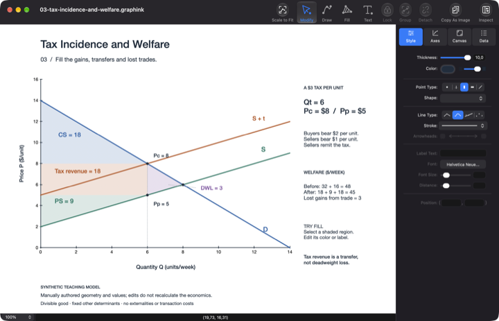
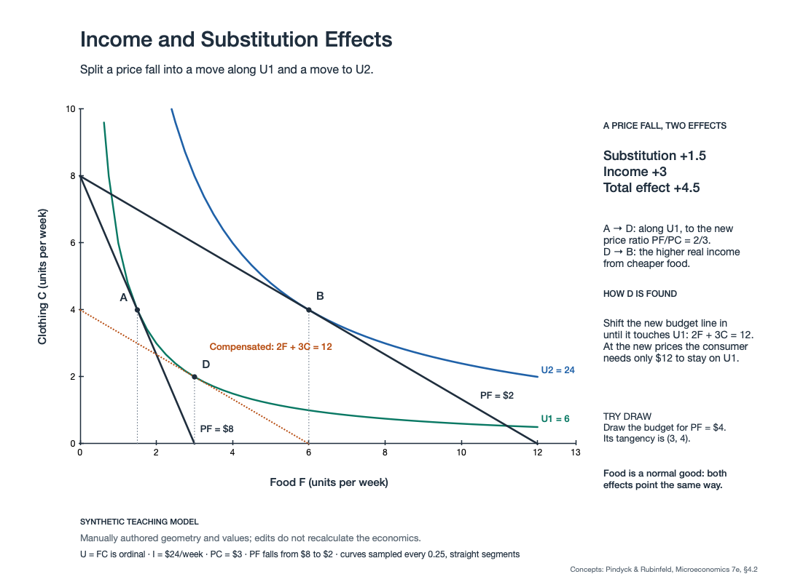
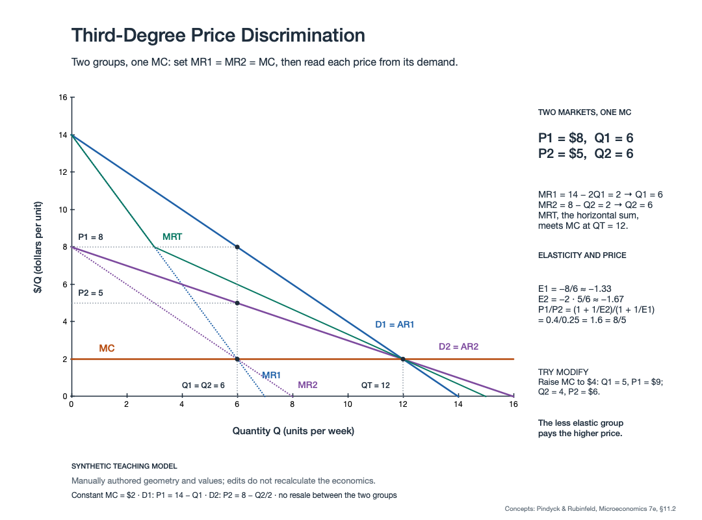
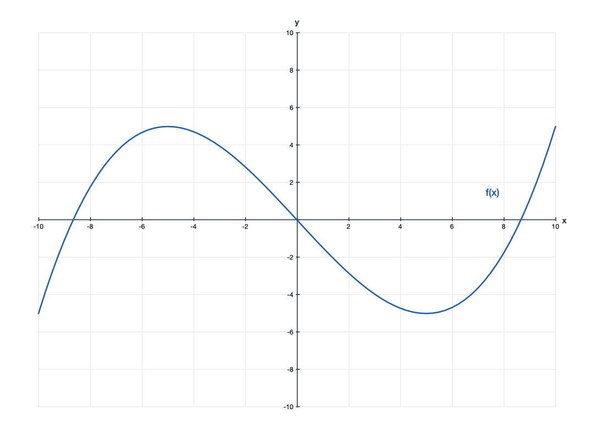
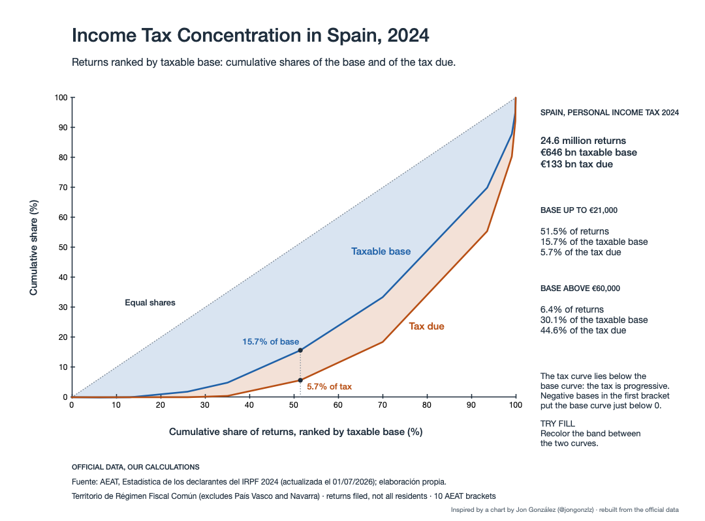

<p align="center">
  <picture>
    <source media="(prefers-color-scheme: dark)" srcset="UI/Graphink/graphink-lockup-dark@2x.png">
    
  </picture>
</p>

<p align="center"><strong>Sketch clean, editable graphs on your Mac.</strong><br>
Draw a graph without any data, or paste a table and plot it. Export sharp PDF and images.</p>

<p align="center">
  <a href="https://github.com/diegomarino/graphink/releases/latest">Download</a> ·
  <a href="#features">Features</a> ·
  <a href="#examples">Examples</a> ·
  <a href="#command-line-and-agents">Command line</a> ·
  <a href="#build-from-source">Build</a>
</p>



## Features

- **Draw first, data optional.** Sketch lines, curves, points, fills and labels straight on the
  axes. Everything stays editable and snaps to the grid and to what is already there.
- **Plot real data.** Paste a table from a spreadsheet and it becomes points and lines you can
  restyle like anything else.
- **Start from an example.** File ▸ New From has 18 annotated microeconomics graphs, three
  charts built from official data and nine templates, from a function plot to a Lorenz curve.
- **Style presets.** Paper, Sketch, Chalkboard, Studio and Editorial restyle the whole graph in
  one step. Editorial gives a news-chart look: horizontal rules only, no value-axis line and a
  strong blue for new lines.
- **Paper sizes and zoom.** A4, A5 or US Letter in either orientation, zoom from 25% to 400%,
  and the graph never moves when you resize the window.
- **Find.** Search every label with the standard find bar (⌘F, ⌘G).
- **Export.** PDF, or PNG, JPEG and TIFF at 72 to 300 DPI, with the exact pixel size shown first.
- **Command line and agents.** The `graphink` tool exports documents and builds them from a
  short JSON spec, and an agent skill teaches coding agents to use it.
- **An open format.** `.graphink` documents are a small, documented
  [OPC package](docs/format/opc-v1.md). GraphSketcher's `.ograph` files still open and save.

## Examples

Every image below is a document from File ▸ New From, exported by Graphink.

| | |
| --- | --- |
|  |  |
| **Income and substitution effects**, a microeconomics lesson | **Third-degree price discrimination**, a microeconomics lesson |
|  |  |
| **Function plot**, a template | **Income tax concentration in Spain**, a chart from official data |

## Command line and agents

The `graphink` command creates and exports documents without opening the app:

```bash
graphink render lesson.graphink -o lesson.pdf          # or .png/.jpg/.tiff, --scale 2, --dpi 300
graphink create plot.json -o plot.graphink             # a JSON spec, built with Graphink's own model
```

It ships inside the app: choose **Graphink ▸ Install Command-Line Tool…** and run the command it
shows to put `graphink` on your `PATH`. Every release also attaches `graphink-cli.zip`, the same
tool on its own. Details: [tools/cli/README.md](tools/cli/README.md).

The [graphink agent skill](skills/graphink/SKILL.md) teaches Claude Code and other coding agents to
plan a graph, write its spec, create it, render it and check the image before handing it over:

```bash
npx skills add diegomarino/graphink
```

Both need a Mac: the tool draws with macOS's own frameworks.

## Download

Get `Graphink.dmg` from [Releases](https://github.com/diegomarino/graphink/releases/latest).
Graphink runs on Apple silicon Macs. The current build is not notarized yet, so the first time
you open it, allow it in System Settings ▸ Privacy & Security.

## Build from source

You need Xcode 27 on an Apple silicon Mac.

```bash
git clone https://github.com/diegomarino/graphink.git
cd graphink
.github/scripts/bootstrap-omnigroup.sh
.github/scripts/build.sh Debug /tmp/graphink-build
open /tmp/graphink-build/Debug/Products/Debug/Graphink.app
```

[docs/BUILDING.md](docs/BUILDING.md) explains the OmniGroup patches, Release builds and the
document checks. To contribute, see [CONTRIBUTING.md](CONTRIBUTING.md).

## Credits and license

Graph Sketcher was created by Robin Stewart in 2007 and developed further by The Omni Group as
OmniGraphSketcher, which open-sourced it in 2014 as
[GraphSketcher](https://github.com/graphsketcher/GraphSketcher). Graphink continues that code
for current macOS; the first 26 commits of this repository are the original history.

New work is under the [MIT License](LICENSE). The inherited GraphSketcher code stays under the
[Omni Source License 2007](OmniSourceLicense.html), and third-party components keep their own
terms: [NOTICE.md](NOTICE.md) lists which license covers which files. Graphink is not
affiliated with or endorsed by The Omni Group.
